# ROS2 MRAC Lower-Limb Exoskeleton

A Model Reference Adaptive Control (MRAC) framework for an **8-DOF lower-limb exoskeleton** in ROS2 (C++, `rclcpp` + Eigen). The controller tracks a sinusoidal gait trajectory on both legs, adapts its estimate of the leg dynamics online, and logs data for tracking-error analysis.

**Result:** across the analysed joints, RMSE stayed between **0.13° and 0.74°** over a ~170 s gait run (see [Results](#results)).

## Highlights

* Adaptive controller in C++, running at **1 kHz**
* Online estimation of **24 parameters** (inertia, damping and gravity terms for each of the 8 joints)
* Sinusoidal gait reference at **0.5 Hz** (2 s gait cycle), left leg 180° out of phase with the right
* Safety layer: per-joint torque limits, torque slew-rate limit, start-up settling and ramp, bounded parameters
* Gains tunable at runtime as ROS2 parameters
* URDF/Xacro model visualised in RViz2
* Tracking analysis with RMSE, MAE and peak error per joint

## Exoskeleton model

Each leg has 4 revolute joints. Limits and effort values come from `urdf/exoskeleton.urdf.xacro`.

| Joint | Function | Range (rad) | Max torque (Nm) |
|---|---|---|---|
| `right_joint_1` / `left_joint_1` | Hip abduction / adduction | −0.523 to 0.523 | 50 |
| `right_joint_2` / `left_joint_2` | Hip flexion / extension | −0.349 to 1.920 | 80 |
| `right_joint_3` / `left_joint_3` | Knee flexion | 0 to 2.094 (left: 2.049) | 100 |
| `right_joint_4` / `left_joint_4` | Ankle | −0.524 to 0.349 | 100 (left: 50) |

## Control method

The controller uses an MRAC adaptive law of the Slotine–Li type. With tracking error `e = q − q_d`:

| Step | Equation |
|---|---|
| Sliding surface | `s = ė + Λ e` |
| Reference velocity / acceleration | `q̇_r = q̇_d − Λ e`, `q̈_r = q̈_d − Λ ė` |
| Regressor (per joint *i*) | `Y_i = [ q̈_r,i , q̇_r,i , sin(q_i) ]` → inertia, damping, gravity |
| Adaptation law | `θ̂̇ = −Γ Yᵀ s` (each θ̂ bounded to ±20 to prevent drift) |
| Control torque | `τ = Y θ̂ − K_d s` |

**Default gains** (ROS2 parameters): adaptation gain Γ = 0.5, Λ = 4.0, K_d = 2.5.

### Gait reference (rad, ω = 2π·0.5)

| Joint | Desired trajectory |
|---|---|
| Hip ab/adduction | `0.08 sin(ωt)` |
| Hip flexion | `0.35 sin(ωt) + 0.15` |
| Knee | `0.55 · max(0, −sin(ωt))` (flexes only during swing) |
| Ankle | `−0.18 sin(ωt)` |

The left leg uses `ωt + π`. All references are clamped to the URDF joint limits. The `protect_left_knee` parameter (default `true`) reduces the left knee amplitude to 0.08 rad.

### Safety features

* **Per-joint torque saturation** using the URDF effort limits
* **Slew-rate limit** of 500 Nm/s (0.5 Nm per 1 ms tick) to avoid actuator current spikes
* **Start-up settling:** zero torque for 2 s after the first joint state arrives, then a linear ramp to full torque over 2 s
* **Parameter bounds** on θ̂

### ROS2 interface

| Direction | Topic | Type |
|---|---|---|
| Subscribes | `/measured_joint_states` | `sensor_msgs/JointState` |
| Publishes | `/mrac_joint_commands` | `std_msgs/Float64MultiArray` (joint torques) |
| Publishes | `/joint_states` | `sensor_msgs/JointState` (for RViz / TF) |
| Publishes | `/mrac_desired_states` | `sensor_msgs/JointState` (reference, for logging) |

**Runtime parameters:** `adaptation_gain`, `lambda_gain`, `kd_gain`, `torque_rate_max`, `settling_time`, `protect_left_knee`

## Results

Gait trajectory tracking over a ~170 s run (≈85 gait cycles). Error metrics for the hip ab/adduction, hip flexion and ankle joints of both legs:

| Joint | Description | RMSE (rad) | MAE (rad) | Max error (rad) | RMSE | MAE | Max error |
|---|---|---|---|---|---|---|---|
| `right_joint_1` | Right hip ab/adduction | 0.002201 | 0.000285 | 0.116069 | 0.126° | 0.016° | 6.65° |
| `right_joint_2` | Right hip flexion/extension | 0.012829 | 0.001368 | 0.681678 | 0.735° | 0.078° | 39.06° |
| `right_joint_4` | Right ankle | 0.006053 | 0.000672 | 0.334246 | 0.347° | 0.039° | 19.15° |
| `left_joint_1` | Left hip ab/adduction | 0.003795 | 0.000359 | 0.200618 | 0.217° | 0.021° | 11.49° |
| `left_joint_2` | Left hip flexion/extension | 0.011048 | 0.001302 | 0.547166 | 0.633° | 0.075° | 31.35° |
| `left_joint_4` | Left ankle | 0.007694 | 0.000755 | 0.395362 | 0.441° | 0.043° | 22.65° |

Also available as [`results/rmse_summary.csv`](results/rmse_summary.csv).

**Observations**

* Desired and actual trajectories almost overlap on every joint, and the tracking error stays small and bounded throughout the run.
* RMSE is below 0.75° on all six joints. The hip flexion joints have the highest error, as expected, because they have the largest range of motion (about 40°) and carry the most load.
* The peak errors come from short, isolated single-sample spikes. This is why the MAE is about 10× smaller than the RMSE. Finding the source of these spikes is listed under future work.

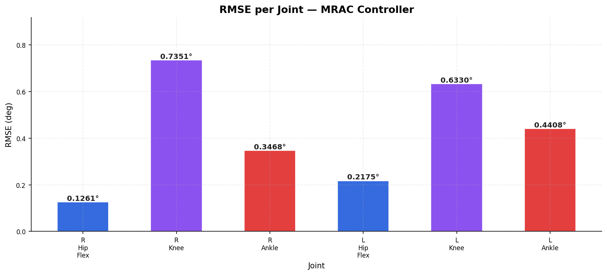

### Desired vs actual position

> Note: the titles printed inside the plot images use earlier joint labels. The captions below give the correct joint names.

**Right hip ab/adduction**
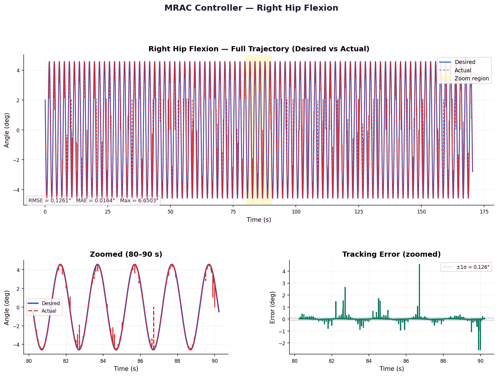

**Right hip flexion/extension**
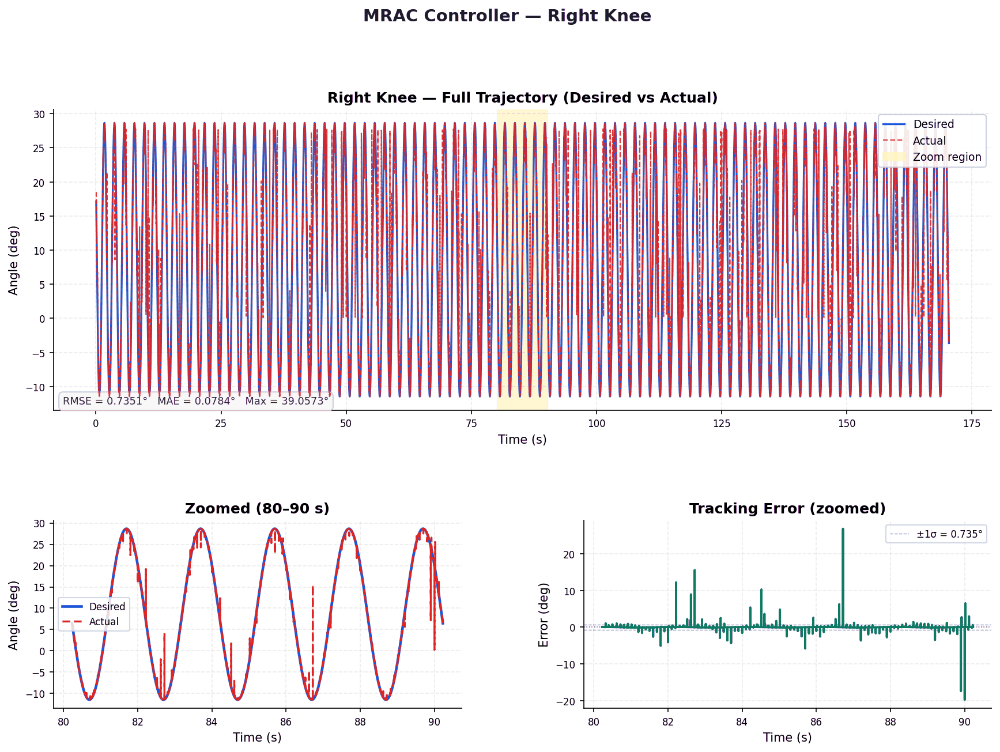

**Right ankle**
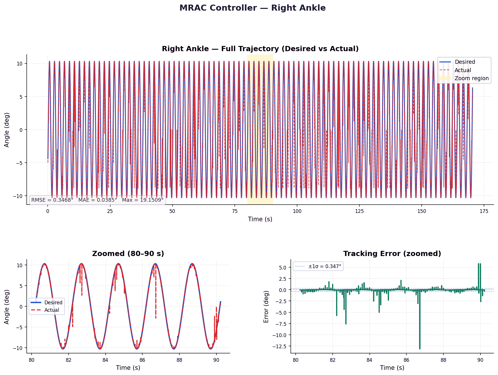

**Left hip ab/adduction**
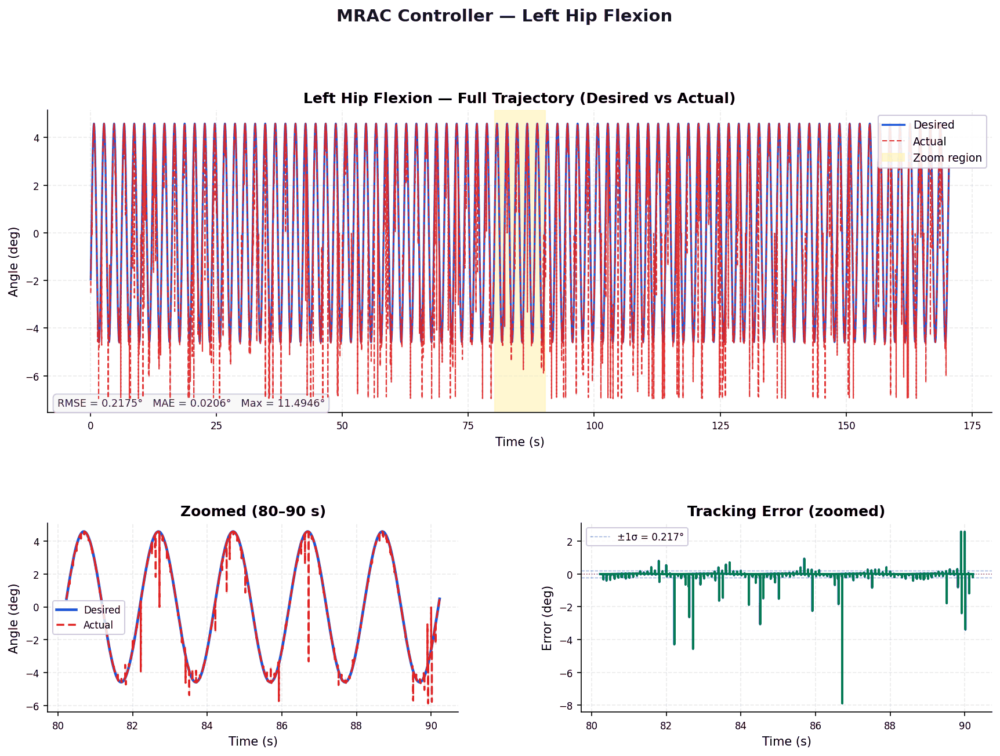

**Left hip flexion/extension**
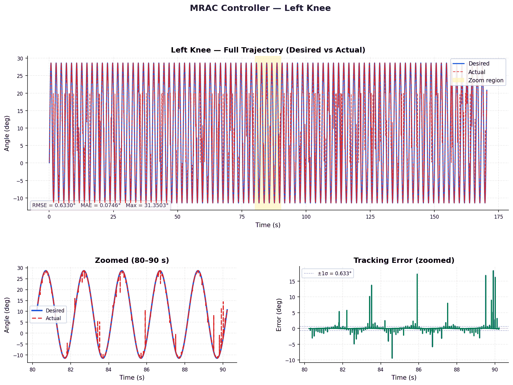

**Left ankle**
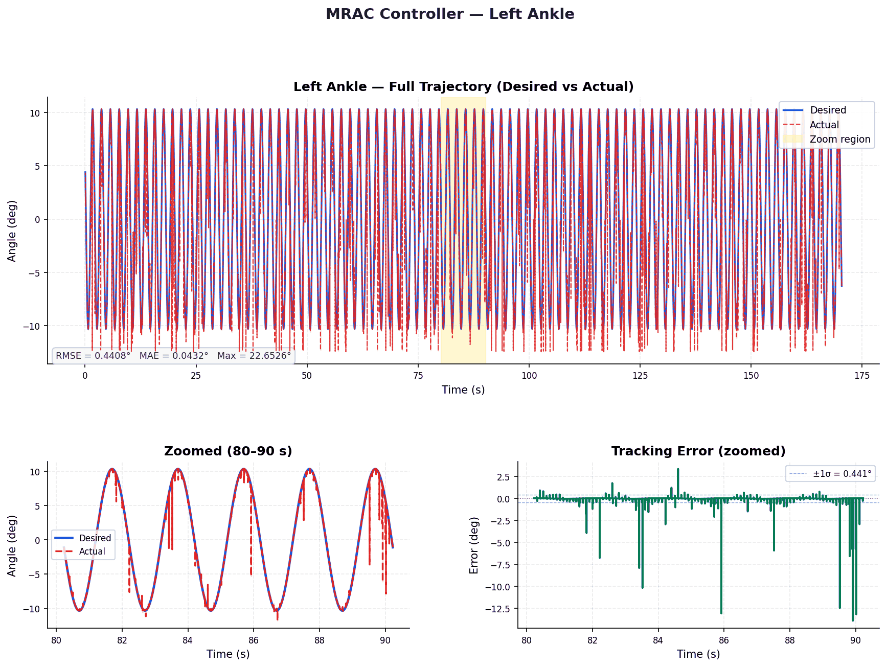

### Tracking error

<details>
<summary>Show tracking-error plots for all six joints</summary>

**Right hip ab/adduction**
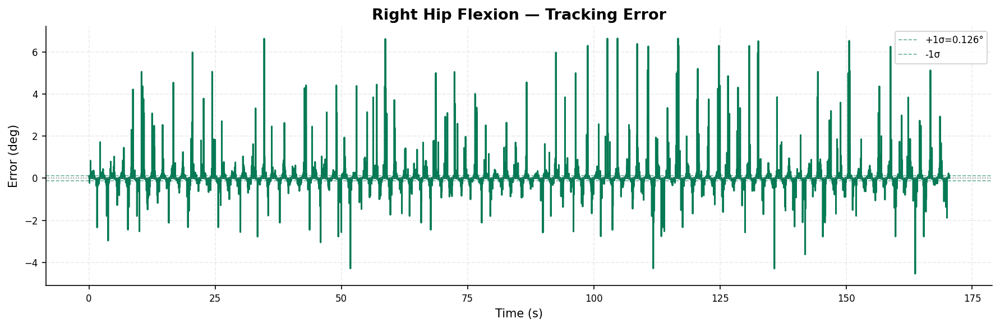

**Right hip flexion/extension**
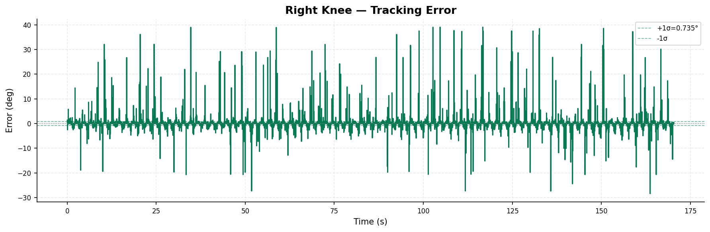

**Right ankle**
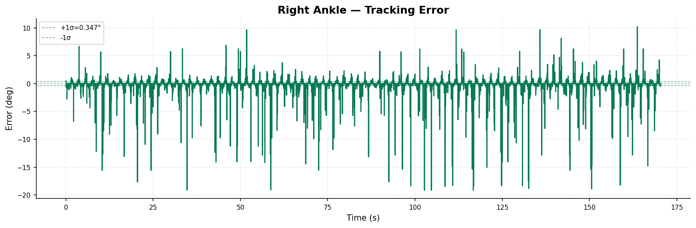

**Left hip ab/adduction**
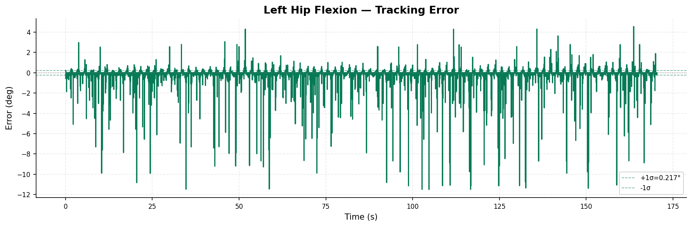

**Left hip flexion/extension**
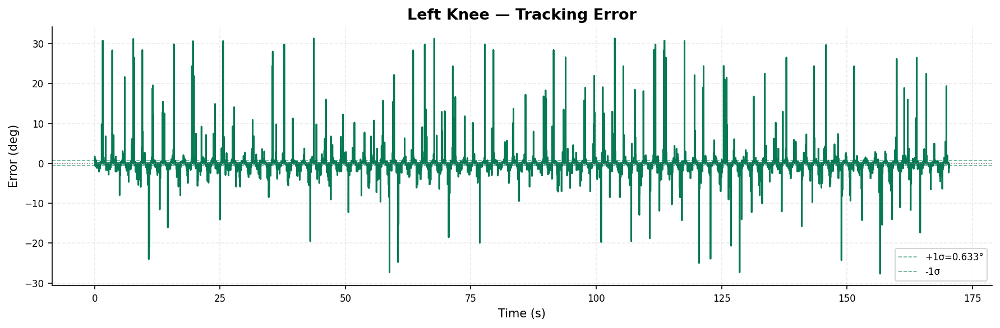

**Left ankle**
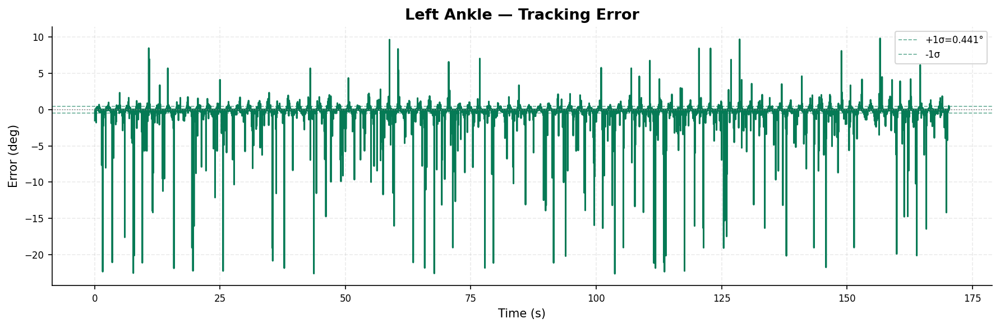

</details>

## Repository structure

```
adaptive_controller/
├── src/mrac_controller.cpp                     # MRAC controller node (1 kHz)
├── include/adaptive_controller/mrac_controller.hpp
├── urdf/exoskeleton.urdf.xacro                 # 8-DOF exoskeleton model
├── meshes/                                     # STL meshes used by the URDF
├── launch/display.launch.py                    # robot_state_publisher + RViz2
├── rviz/exoskeleton.rviz
├── scripts/mrac_error_analysis_ros2.py         # live RMSE / MAE / peak-error monitor
└── results/
    ├── rmse_summary.csv
    └── plots/
```

## Build

```bash
cd ~/ros2_ws
colcon build --packages-select adaptive_controller
source install/setup.bash
```

Requires ROS2 Jazzy, Eigen3, `robot_state_publisher`, `joint_state_publisher_gui` and `rviz2`.

## Run

```bash
# Terminal 1 – model + RViz
ros2 launch adaptive_controller display.launch.py

# Terminal 2 – controller (gains can be overridden)
ros2 run adaptive_controller mrac_controller --ros-args -p adaptation_gain:=0.5 -p lambda_gain:=4.0 -p kd_gain:=2.5

# Terminal 3 – optional live error analysis
ros2 run adaptive_controller mrac_error_analysis_ros2.py
```

## Future work

* Report knee tracking results alongside the other joints
* Investigate and remove the isolated error spikes, for example by synchronising timestamps between desired and measured states
* Use a realistic gait reference (e.g. clinical gait data) instead of sinusoids
* Full dynamic simulation in Gazebo with ground contact
* Compare with PID and computed-torque control

## Author

**Bipasha Deka**
B.Tech Mechanical Engineering, Tezpur University
[GitHub](https://github.com/bipashadeka) · [LinkedIn](https://www.linkedin.com/in/bipasha-deka/)
